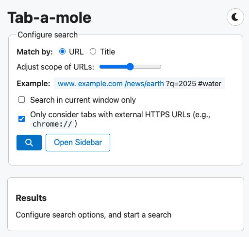
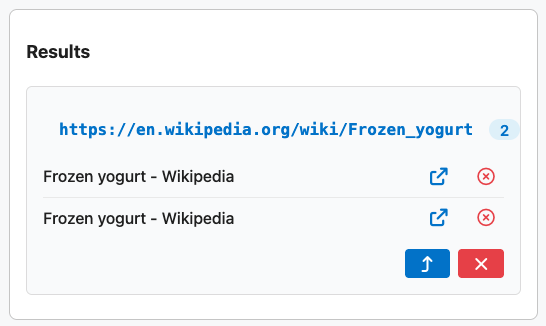
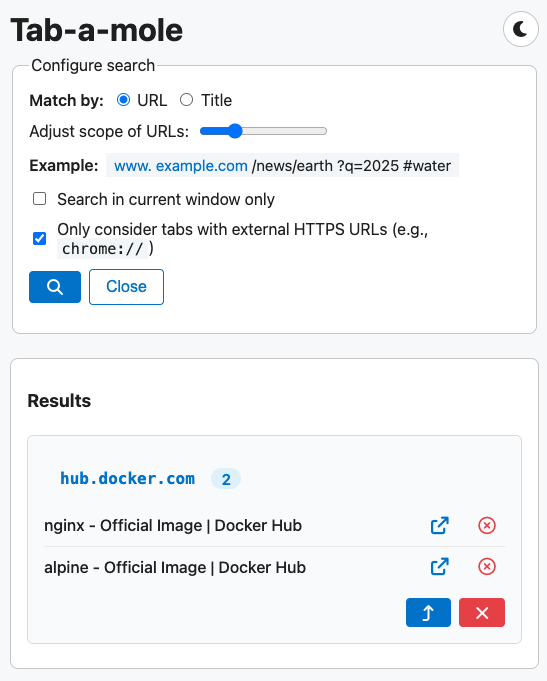

# Tab-a-mole

[](https://github.com/jzer7/tab-a-mole/actions/workflows/build.yml)

Tab-a-mole is a Chrome extension that helps you find and manage duplicate tabs.

## Features

- **Find duplicate tabs** by URL or title similarity
- **Flexible URL matching** by full URL, URL without its fragment, URL without
  its query and fragment, hostname, or the last two hostname labels
- **Title matching** using Jaccard similarity
- **Window-scoped search** to limit results to the current window or search
  across all windows
- **HTTPS filtering** to include only tabs with `https://` URLs
- **Quick actions** to navigate to tabs or close duplicates
- **Popup and sidebar views** for searching and reviewing duplicate tabs
- **Theme toggle** switches between light and dark appearance; the initial
  appearance follows the system theme
- **Time tracking** shows when tabs were last accessed

## Installation

### From Chrome Web Store

Not available yet.

### Manual Installation

1. Download the ZIP file for the latest release from
   [GitHub Releases](https://github.com/jzer7/tab-a-mole/releases)
2. Extract the ZIP file
3. Open Chrome and go to `chrome://extensions/`
4. Enable "Developer mode" in the top right
5. Click "Load unpacked" and select the extracted folder

For a development build, follow the setup and build steps below, then load the
`dist/chrome` folder in Chrome.

## Usage

1. Click the Tab-a-mole extension icon in your Chrome toolbar
    <div style="margin:10px">
      
    </div>
2. Choose URL or title matching. URL matching uses the selected URL scope; title
   matching groups titles whose Jaccard similarity is at least 0.5.
3. Optionally limit the search to the current window or include only HTTPS URLs.
   These filters apply to both the popup and sidebar.
4. Click the search button to find duplicates
    <div style="margin:10px">
      
    </div>
5. Review results and take action:
   - Navigate to a tab or its window
   - Close individual duplicate tabs
   - Close all duplicates in a group (keeps one tab open)

The URL scope slider ranges from full URL to the hostname's last two labels.
Intermediate scopes ignore the fragment, then the query and fragment, or the
subdomains and path. The last-two-labels scope uses a simple hostname split and
may not handle public suffixes such as `co.uk`.

For example, this search only considers the `hostname` part of the URL.

   <div style="margin:10px">
     
   </div>

Use the theme button to switch between light and dark appearance. On first use,
the extension follows the system theme.

## Development

This project is coded in TypeScript and uses Bun to manage the environment.

This extension relies on the `chrome.*` APIs directly, so it only works on
Chrome-based browsers (Chrome, Chromium, Edge, Brave, etc.). Firefox and Safari
are not supported. To install the extension for development:

1. Clone or download this repository.
2. Install dependencies and the development browser with `make setup`.
3. Build the extension with `make build`.
4. Open Chrome and go to `chrome://extensions/`.
5. Enable "Developer mode" and click "Load unpacked".
6. Select the generated `dist/chrome` directory.

`make dev` starts the development server with hot reloading. The Makefile's
`EXTJS_BROWSER` variable defaults to `chromium`; override it for a Make target
with, for example, `make dev EXTJS_BROWSER=chrome`.

### Common make targets

| Target              | Description                             |
| ------------------- | --------------------------------------- |
| `make setup`        | Install dependencies                    |
| `make build`        | Build the extension                     |
| `make dev`          | Start the dev server with hot reloading |
| `make package`      | Package the extension as a ZIP          |
| `make test`         | Run tests                               |
| `make lint`         | Run linters                             |
| `make format-check` | Check code formatting                   |
| `make format-fix`   | Fix code formatting                     |
| `make qa`           | Run audit, lint, formatting, and tests  |
| `make clean`        | Remove build artifacts                  |

Run `make help` to see the full, up-to-date list of targets.

### To debug

1. Start the development server:

   ```sh
   make dev
   ```

2. This launches an isolated browser profile and keeps running in the
   foreground, holding the terminal (press `Ctrl+C` to stop it).

3. The browser will load the extension automatically. Any changes to the code
   will be reflected on the extension.

## Known Limitations

- Title matching uses
  [Jaccard similarity](https://en.wikipedia.org/wiki/Jaccard_index) with a
  default threshold of 0.5, which may not catch all semantically similar titles.

## Contributing

Feel free to open issues or submit pull requests for improvements or bug fixes.

## License

This project is licensed under the MIT License. See the [LICENSE](LICENSE) file
for details.

:golf:
